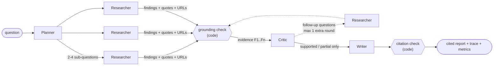

# dossier

**A multi-agent research team built directly on the Claude API, with no agent framework.**
A planner splits a question, researchers investigate the parts in parallel with web search, a
critic fact-checks every claim against its quoted source, and a writer turns what survives into
a cited report. Plain code then checks every citation before you see it.

It ships with an eval that compares the team against a single agent on the same model and tools.
A team is only worth its complexity if it does measurably better per dollar.

[](https://github.com/dojedaro/dossier/actions/workflows/ci.yml)



## Why it's built this way

| Decision | Why |
|---|---|
| **No framework.** Orchestration is under 200 lines of `asyncio` (`orchestrator.py`). | You can read the whole control flow in one file. Agents decide *what* to research and *what* to say; code decides how many run, in what order, under what budget, and which evidence may be used. |
| **Typed hand-offs.** Each agent's output is a Pydantic model, enforced by structured outputs or a strict tool schema (`schemas.py`). | An agent can't pass the next one malformed data: it validates or the call fails. |
| **Evidence ids come from code.** A model never makes up `F7`. | A model can't invent a citation that looks valid. |
| **Grounding is checked in code.** A finding must cite a URL that one of *that researcher's own searches* returned (`grounding.py`). | This catches the most common multi-agent fabrication, a real-looking URL from memory, without trusting any model. |
| **The critic isn't the researcher.** It judges each claim *only* against its quote. | A model checking its own work tends to approve it. Unsupported claims are dropped before writing. |
| **The writer's citations are checked too.** Citations to ids that don't exist or were rejected are stripped and counted. | Every number in the report traces back to a quote and a URL. |
| **Failure isolation.** Each researcher has a timeout; one failure costs one sub-question, not the run. | `asyncio.TaskGroup` gives structured concurrency; per-task error capture keeps one failure from cancelling the others. |
| **A budget with a reserve.** Research stops when spending reaches `budget - reserve`; the critic and writer finish on the reserve. | A run that runs out of money still ends with a report, not an exception. |
| **Traces.** Every agent step is a span, nested correctly across parallel tasks via `contextvars`. | `dossier trace` shows who did what, how long it took and what it cost. |
| **Refusal fallbacks.** On a safety-classifier decline the API retries on a fallback model in the same call (`fallbacks="default"`). The trace records which model actually answered. | One false-positive refusal doesn't fail a researcher. |
| **A fake model for tests.** It implements the same two-method interface as the real client. | The whole pipeline runs in CI with no API key and costs $0. |

## Quick start

```bash
pip install -e ".[dev]"

# Offline: full pipeline against the fake model, $0
dossier run "Should a mid-size bank adopt passkeys?" --fake

# Real run: needs ANTHROPIC_API_KEY (or `ant auth login`)
dossier run "Should a mid-size bank adopt passkeys?"
dossier run "..." --baseline                      # the single-agent control
dossier --config configs/quick.toml run "..."     # fewer sub-questions, no follow-up round

dossier trace runs/<run>/trace.jsonl              # where the time and money went
```

Each run writes `report.md`, `metrics.json` and `trace.jsonl` to `runs/<timestamp>-<slug>/`.

```
team question='Should a mid-size bank adopt passkeys?'                    41.8s
  llm:planner                                                              6.1s   $0.0310
  research_round round=1                                                  27.4s
    researcher sub_question='What phishing resistance do passkeys ...'    24.9s
      llm:researcher sub_question='What phishing resistance ...'          24.9s   $0.2900
    ...
  llm:critic items=14                                                      4.2s   $0.0400
  llm:writer items=12                                                      4.1s   $0.0700
```
<sub>Layout of `dossier trace` output. Numbers are illustrative, not from a measured run.</sub>

## Does the team beat one agent?

`dossier eval` runs the team and the single-agent baseline on `evals/questions.jsonl`, using the
same model, the same web search tool and a matching search allowance. It then reports two kinds
of evidence:

- **Deterministic metrics** from the grounding checks: findings that cite a URL no search
  returned, citations removed, findings the critic rejected, cost and wall time. No model is
  involved, so there's no judge bias.
- **A pairwise LLM judge**, run twice per question with the reports' positions swapped. A side
  wins only if it wins in both orders; a split verdict counts as a tie. This cancels position
  bias, the most common failure of LLM judges. The fake judge in the test suite always prefers
  position A, and a test checks that the swap turns every one of its verdicts into a tie.

**Results: not run yet.** A full run of 8 questions costs roughly $25-40 on Claude Opus 5.5.
Results will go here when they exist, including any where the baseline wins.

## Configuration

Defaults are in `src/dossier/config.py`, and any TOML file can override them:

```toml
# configs/cheap-workers.toml: researchers do most of the reading, so they dominate cost
[models.researcher]
model = "claude-sonnet-5-5"
effort = "medium"
```

Every role (`planner`, `researcher`, `critic`, `writer`, `baseline`, `judge`) has its own model,
effort level and token limit. Run the eval before and after a change to see what it costs in quality.

## Layout

```
src/dossier/
  orchestrator.py    the team's control flow, plus the baseline
  agents/            planner, researcher, critic, writer, baseline: one prompt + one call each
  llm/               the model interface; Claude client; deterministic fake
  grounding.py       URL and citation checks that trust no model
  schemas.py         typed contracts between agents
  budget.py  pricing.py  tracing.py
  evaluation.py      team vs. baseline, swapped-position judge
tests/               37 tests; the real client is tested against a stubbed SDK
```

## Limitations

- **The critic checks claims against quotes, not quotes against pages.** Web search returns
  page content encrypted, so code can't confirm that a quote appears on the page. The URL
  check is deterministic; the quote check is not.
- **The budget is soft.** Researchers run in parallel, so several can pass the budget check at
  once. The overshoot is at most one call per parallel researcher, which the reserve absorbs.
- **Fallback costs are approximate.** If a fallback model serves part of a request, the whole
  call is billed at that model's rates.
- Prices in `pricing.py` are hard-coded (first-party API, 2026-11). Check the pricing page
  before relying on them for real spend.

## License

MIT
